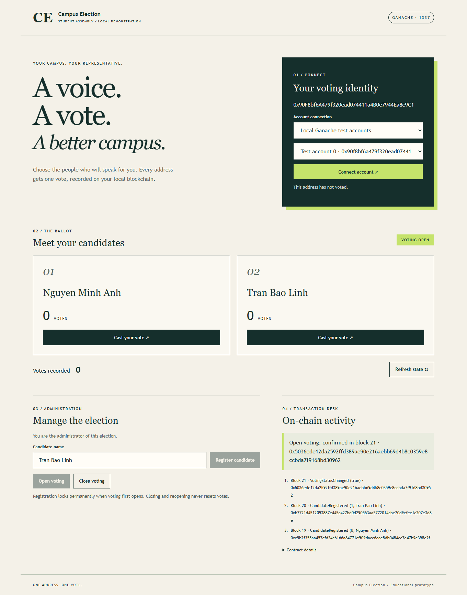
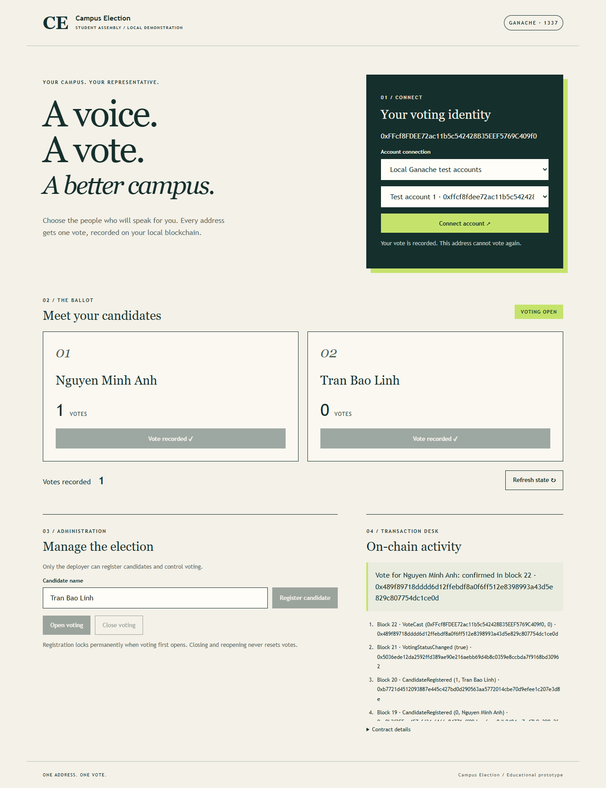
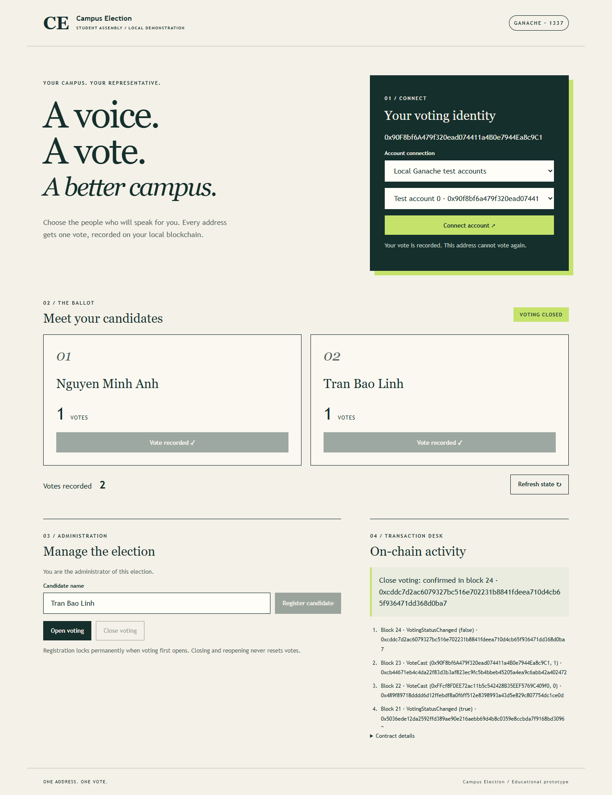
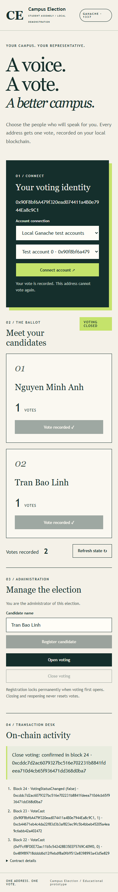

# Campus Election

Solution to `ASSIGNMENT.md`: a Solidity election deployed to local Ganache with an HTML/JavaScript interface using ethers.js. All project files are inside this `python` folder despite the folder name. The pre-existing Python starter files are unrelated and are preserved.

## Prerequisites and network

- Node.js 22 or 24 and npm. Verified here with Node 24.13.0.
- Install dependencies with `npm ci` (use `npm install` if intentionally updating dependencies).
- Optional: MetaMask or another injected Ethereum browser wallet.
- RPC: **http://127.0.0.1:7545**; chain ID **1337** (`0x539`); currency **ETH**; network name **Campus Ganache**. Network ID is also 1337.
- Only local Ganache accounts and test Ether are used. Scripts use unlocked local accounts and require no private keys. Never import a personal wallet into this demonstration.

Port 7545 is intentional: another Hardhat chain occupied port 8545 during implementation. Ganache binds to localhost only. Its ten deterministic accounts are public test identities; never use them on a public network. Chain data is in memory and disappears when Ganache stops.

## Deploy and run

Run from this directory. Keep the first two terminals running:

```powershell
# Terminal 1
npm ci
npm run chain

# Terminal 2
npm run deploy
npm start
```

Open **http://127.0.0.1:8080**. Deployment creates the ABI/bytecode in `artifacts/CampusElection.json` and the address/ABI in `web/deployment.json`. The interface loads ethers from the locally installed dependency, without a CDN.

For the simplest demonstration, choose **Local Ganache test accounts**, select **Test account 0**, and connect. This uses genuine Ganache transactions through its unlocked-account RPC; it does not require a wallet extension. Account 0 is the administrator because the deployment script uses that account.

For the browser-wallet path, add the Ganache network above to MetaMask, and use an account from this local Ganache instance. You can import a **disposable Ganache test account** using Ganache's account tools; never use real keys. Choose **Browser wallet (MetaMask)** and connect. Approve each transaction in the wallet. The app displays the connected address and reports network errors, wallet rejection, pending transaction hashes, confirmations, and contract rejection reasons. Wallet account/network changes require reconnecting. Local account mode is provided so the entire demonstration can run without importing any keys.

If you restart Ganache, run `npm run deploy` again, then reload and reconnect. Each deployment creates a new election; there is no reset function. Do not run deployment or demo scripts while someone is using the previous election.

## Manual demonstration

1. Connect account 0. Register **Nguyen Minh Anh** and **Tran Bao Linh**.
2. Open voting. Registration now stays locked permanently.
3. Select account 1 and reconnect. Administrator controls are disabled. Cast a vote for the first candidate. The total becomes 1; the transaction hash and `VoteCast` event appear.
4. This account's voting buttons are disabled after its vote. A direct second vote also reverts in the contract, as proven by the demo and tests below.
5. Select account 0 and reconnect. Vote for the second candidate. Each candidate has 1 vote; total votes = 2.
6. Close voting. Further votes revert. Reopening is allowed, but does not reset votes, voter records, or candidate registration.

At least two candidates are required to open voting. Names must be nonblank and 1–80 UTF-8 bytes; exact duplicate names are rejected. Names differing in capitalization or whitespace are different strings. Candidate IDs are zero-based and registration order is preserved.

## Tests and evidence

```powershell
npm test

# With Ganache running: fresh deployment is required before either demo.
npm run deploy
npm run demo

# Browser automation requires a fresh election and the web server running.
npx playwright install chromium
npm run deploy
npm run test:browser
```

Verified on 2026-11-17:

- **8/8 contract tests passed** against in-process Ganache: initial state, administrator permissions, candidate validation, opening prerequisites, invalid/closed voting, two independent voters and a mined repeat-vote revert, close/reopen persistence, and state-change events.
- **RPC demonstration passed** against Ganache on port 7545. `evidence/demo-results.json` records successful transactions and three transactions mined with status 0: unauthorized opening (`Administrator only`), duplicate voting (`Address already voted`), and late registration (`Registration closed`). Revert reasons are also checked with `eth_call` before submitting the deliberately invalid transactions. Reverted transactions consume test gas but change no election state.
- **Browser workflow passed** using real Ganache accounts: registration, opening, voting from two accounts, disabled repeat voting and unauthorized controls, event display, closing, and mobile overflow checks. No page errors occurred. See `evidence/browser-results.json` and four screenshots below. The MetaMask extension approval flow is a manual check; it was not automated.

Screenshots from the browser demonstration:






The RPC demo and browser demo deploy separate contract instances, so their addresses and transaction hashes differ. JSON evidence and screenshots describe those historical runs; a new deployment does not rewrite them automatically. Ganache on Node 24 reports a missing optional native uWS binary and falls back to its JavaScript implementation; the tests and RPC demonstration still pass.

## Source map and individual explanation

- `contracts/CampusElection.sol`: immutable deployer administrator; `onlyAdministrator` checks permissions; `hasVoted` enforces one vote per address; `registrationClosed` permanently fixes the list; events describe registration, voting status, and votes.
- `web/index.html`, `web/style.css`, `web/app.js`: responsive interface, injected-wallet and local-account connections, candidates/totals, administrator actions, transaction/error reporting, and event history. Use Refresh state to see changes submitted elsewhere.
- `scripts/compile.mjs`: pinned Solidity compiler with Shanghai EVM target for Ganache compatibility.
- `scripts/chain.mjs`, `deploy.mjs`, `demo.mjs`, `serve.mjs`: local network, deployment, repeatable evidence, and local static server.
- `tests/election.test.mjs`, `scripts/browser-demo.mjs`: contract and browser verification.

The contract checks voting period, voter history, and candidate ID before recording a vote. A rejected vote leaves the voter mapping, candidate totals, and total count unchanged. Closing only pauses the period; it never erases a vote. Interface buttons reflect permissions, while contract checks remain authoritative even when called directly.

This is an educational address-based election. It does not verify student identity: a person controlling multiple addresses can vote multiple times. Votes and voter addresses are public; there is no secret ballot, eligibility registry, audit, or production-election guarantee.

## References and assistance disclosure

Original assignment supplied by the user in `ASSIGNMENT.md`. Implementation and documentation were created with OpenAI Codex assistance; review and understand the code and follow your course's rules for declaring assistance before submission. Do not claim unaided authorship.

- [Solidity documentation](https://docs.soliditylang.org/en/latest/) — contracts, access modifiers, mappings, events, and revert behavior.
- [ethers.js v6 documentation](https://docs.ethers.org/v6/single-page/) — BrowserProvider, JsonRpcProvider, contracts, and transaction receipts.
- [Ganache CLI reference](https://archive.trufflesuite.com/docs/ganache/reference/cli-options/) — local blockchain settings and test accounts. This project explicitly sets its port and chain ID.
- [Playwright documentation](https://playwright.dev/docs/intro) — browser automation and screenshots.

No third-party election-contract template was copied. Dependencies are pinned in `package.json` and `package-lock.json`.
